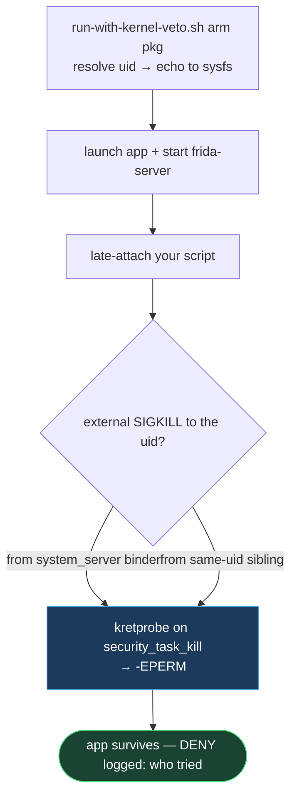

# Module 04 · Kernel Veto — Run Any DexProtector App Under an In-Kernel SIGKILL Veto

> **Confidentiality:** Internal · **Author:** CSI · **Company:** [Hacktivate Co., Ltd.](https://hacktivate.tech/)
> **Module:** `04_kernel_veto/` · **Tier:** 4 (external / system-mediated kill) · **Runner:** `run-with-kernel-veto.sh`

## Overview

The host-side runner for the **in-kernel `dexp_veto` SIGKILL-veto** — the kernel-level defeat
of DexProtector's *external* anti-Frida watchdog. Where [Module 02](../02_watchdog_killnop/)
(killnop) and [Module 03](../03_frida_survival_kit/) (self-targeted seccomp) beat the
**in-process** kill, this tier beats the kill that comes from **another process**
(`system_server` binder, same-uid app siblings) — which no in-process mitigation can touch.
Proven on `com.playnet.androidtv.ads` (2026-10-17): Frida attached, 27,755 classes, survived
64 s+ where it died in ~1 s before.

> **This folder is the runner + control surface.** Building and flashing the kernel driver
> itself is documented separately in [`DRIVER_README.md`](DRIVER_README.md).

**Prerequisite:** a kernel built with `CONFIG_DEXP_VETO=y` flashed (node `/sys/kernel/dexp_veto`
exists). Build/flash: see [`DRIVER_README.md`](DRIVER_README.md).



## The one key device quirk

On this ROM, `adb shell su -c 'echo X > /sys/...'` **fails** (the redirect runs in a weaker
context), even in permissive. Use **`su 0 -c "..."`** — full root (`u:r:ksu:s0`) — which
`run-with-kernel-veto.sh` does for you. Reads of the node are SELinux-gated under Enforcing,
but writes via `su 0 -c` work in Enforcing; no permissive needed.

## Quick start

```bash
# arm + launch + frida, all in one (the app survives the attach):
PYENV_VERSION=frida17 ./run-with-kernel-veto.sh run com.playnet.androidtv.ads alive_test.js

# or step by step:
./run-with-kernel-veto.sh arm com.playnet.androidtv.ads      # point the veto at its uid
./run-with-kernel-veto.sh status                              # uid=10293 verbose=1 ...
./run-with-kernel-veto.sh log                                 # dmesg DENY lines = who tried to kill it
./run-with-kernel-veto.sh disarm                              # echo -1
```

Swap the package to target a different DP app — no rebuild. The runner resolves the uid
itself (`stat -c %u /data/data/<pkg>`).

> **Friendly name:** `run-with-kernel-veto.sh` is the clearly-named alias for the script the
> older notes call `veto.sh` — same tool, same arguments.

Env: `SRV` (device frida-server, default `/data/local/tmp/.sysd2`), `PORT`, `PYENV_VERSION`
(match the server), `SER` (adb serial), `KILLNOP` (binary for the optional `--killnop`
in-process layer, default `../02_watchdog_killnop/bin/killnop.arm64`).

## Auto-arm at boot (enable/disable toggle)

The built-in driver resets to `-1` each boot. The KSU module (`dexp_veto_autoarm.zip`) re-arms
automatically, and the **module's toggle in the KernelSU manager is your on/off switch** (this
is why it's a KSU module, not Zygisk — Zygisk injects into apps; we only write a sysfs file at
boot).

```bash
cd ksu-module
# edit uids.txt → the uid(s) to protect (one target; last line wins)
./build.sh                    # produces ../dexp_veto_autoarm.zip
```

Install `dexp_veto_autoarm.zip` in the KernelSU-Next manager → reboot. Toggle the module off
(+ reboot) to stop auto-arming. `customize.sh` refuses to install on a kernel without the veto
node.

> Verify after first reboot: `./run-with-kernel-veto.sh status` should show your uid, not
> `-1`. KSU `service.sh` runs as root at late_start; if a future ROM change blocks the write
> there, fall back to the manual `./run-with-kernel-veto.sh arm <pkg>` per boot.

## When to reach for `--killnop`

`run-with-kernel-veto.sh run <pkg> <script> --killnop` also NOPs the in-process kill syscalls
before attaching (needs `KILLNOP` binary, default `../02_watchdog_killnop/bin/killnop.arm64`).
Usually unnecessary — the veto already blocks in-process *and* external kills — but
belt-and-suspenders for a new target whose startup kill fires before you arm.

## One-tap WebUI

The KSU module ships a WebUI (`ksu-module/webroot/index.html`): resolve pkg↔uid, live
arm/disarm, verbose toggle, DENY-log view.

## Limits

- One protected uid at a time (driver holds a single `target_uid`).
- Defeats the **SIGKILL-watchdog** class only. Anti-ptrace attach-refusal, self-crash, the
  startup refuse-to-decrypt gate, and tamper dialogs are *not* kills — see
  [`WALKTHROUGH.md`](WALKTHROUGH.md) for which tool each needs.

## Layout

| Path | Role |
|---|---|
| `run-with-kernel-veto.sh` (= `veto.sh`) | Host runner: arm / disarm / status / log / run. |
| `alive_test.js` | Survival probe (prints `still alive t=Ns`). |
| `drivers/misc/dexp_veto/` | The in-tree driver source (see [`DRIVER_README.md`](DRIVER_README.md)). |
| `fork-patch/inject.sh` | CI injector — drops the driver into the synced GKI tree. |
| `ksu-module/` | KSU module that auto-arms at boot (+ WebUI). |
| `dexp_veto_autoarm.zip` | Prebuilt auto-arm KSU module. |

## See also

- [`DRIVER_README.md`](DRIVER_README.md) — build + flash the kernel driver.
- [`WALKTHROUGH.md`](WALKTHROUGH.md) — targeting a new app, and triage when it still fights back.
- [Module 05 — Stacked RASP win](../05_appguard_vguard_win/) (needs this flashed) · [Field Manual Ch. 7](../ebook/07_live_frida_ladder.md)
