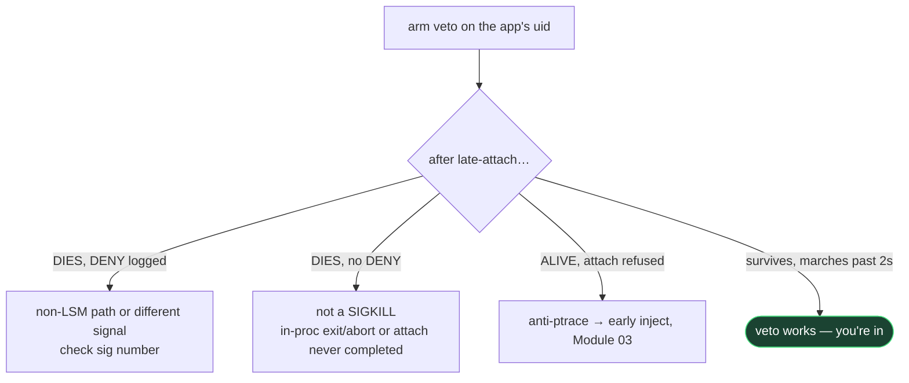

# Module 04 · Walkthrough — Targeting a New App, and Triage When It Fights Back

> **Confidentiality:** Internal · **Author:** CSI · **Company:** [Hacktivate Co., Ltd.](https://hacktivate.tech/)
> **Module:** `04_kernel_veto/`

## Overview

The normal flow for pointing the kernel veto at a new DexProtector app, and the triage tree
for the cases where arming the veto is not enough. The guiding question is always the same:
**does the process DIE, or stay ALIVE?** — because the veto owns the "die" column and nothing
else.

## Normal flow

1. Install the app. Confirm the veto kernel is live: `./run-with-kernel-veto.sh status` (not
   an error).
2. `PYENV_VERSION=<env> ./run-with-kernel-veto.sh run <pkg> alive_test.js`
   - resolves uid → arms the veto → launches → starts frida-server → attaches.
3. Read the result from `alive_test.js`:
   - `still alive t=1s, 2s, 3s …` marching past ~2 s ⇒ **veto works, you're in.**
4. See *who* tried to kill it: `./run-with-kernel-veto.sh log` →
   `DENY sig 9 -> uid N from pid M ('comm')`.
5. Point your real Frida script instead of `alive_test.js`.

## Triage — it still fails after arming

First question — **does the process DIE, or stay ALIVE?**

| Symptom | Diagnosis | Tool |
|---|---|---|
| **Dies**, `./run-with-kernel-veto.sh log` shows `DENY … from pid X` | veto fired but a kill still landed via a non-LSM path, or a *different signal* | check the `sig` number; if death is SIGABRT/SIGSEGV it's a self-crash, not an external kill |
| **Dies**, **no** `DENY` lines | it's not a SIGKILL at all — in-process `exit`/`abort`, or attach never completed | `--killnop` (in-proc exits), or treat as attach-refusal below |
| **Alive**, Frida errors `TimedOutError: waiting for stop` / "refused to load agent" | anti-**ptrace**/anti-debug (blocks the *attach*, not a kill) | veto can't help — needs a ptrace vector (not built); try Zygisk early-inject ([Module 03](../03_frida_survival_kit/)) |
| **Freezes at launch** while armed | blunt veto blocked a kill the app legitimately needs | scope the driver to specific senders (ask) — but note playnet's killers were same-uid, so blunt was required there |
| `ClassNotFoundException` at `instantiateProvider` | startup **refuse-to-decrypt** gate (Frida present during the native gate), not the watchdog | launch clean first (no Frida), or killnop the startup check, then attach ([Module 05](../05_appguard_vguard_win/) does this) |
| Root/tamper **dialog** ("environment not secure") | RASP root detection, independent of Frida | root-hiding (KSU denylist/SUSFS/spoof), not the veto |

> **The short rule:** die → veto/killnop. alive-but-refused → ptrace vector. crash/dialog →
> patch the detector. The veto owns the "die" column.

## Intel to gather on a stubborn target

- **uid:** `adb shell su 0 -c "stat -c %u /data/data/<pkg>"`
- **process topology:** `adb shell su 0 -c "ps -A | grep <pkg>"` — note sibling / isolated-uid
  procs (DP watchdog often spawns them).
- **failure mode:** exact Frida error string, and whether `pidof <pkg>` is alive right after
  the failed attach (ALIVE = ptrace refusal; DEAD = kill).
- **killer identity:** `./run-with-kernel-veto.sh log` — is the sender a `binder:*` thread
  (system_server / framework-mediated), a same-uid sibling (the app's own watchdog), or
  another uid? That tells you the kill's origin.
- **signal:** the veto blocks `sig 9` only. If `DENY` never appears but it dies, the kill may
  use a different signal — the driver's `protect_sig` would need widening (rebuild).

> On playnet the killers were a `binder:1764_*` thread (system_server, framework-mediated)
> **and** same-uid sibling `t.androidtv.ads` processes — which is exactly why the veto had to
> block *all* SIGKILL to the uid, not just "external" senders.

## See also

- [`README.md`](README.md) — the host runner and auto-arm module.
- [`DRIVER_README.md`](DRIVER_README.md) — build + flash the driver.
- [Module 05 — Stacked RASP win](../05_appguard_vguard_win/) — when the target also has AppGuard + vGuard.
